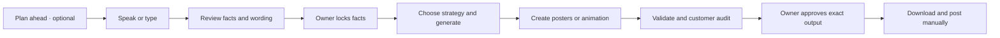
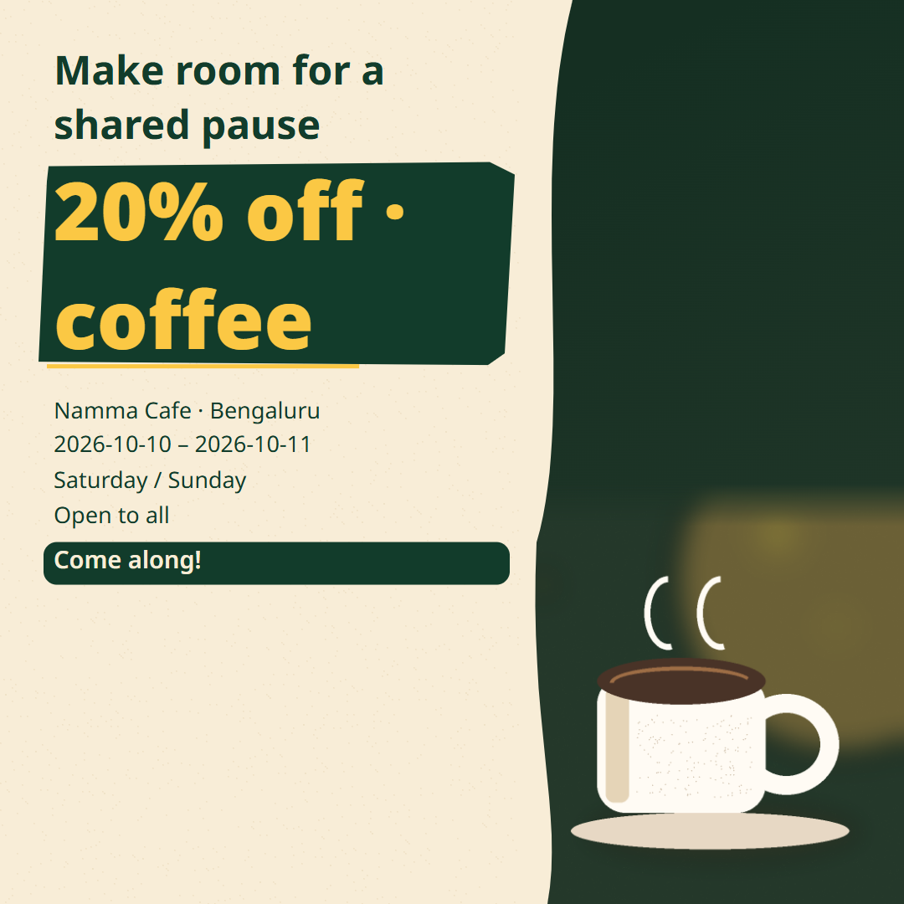
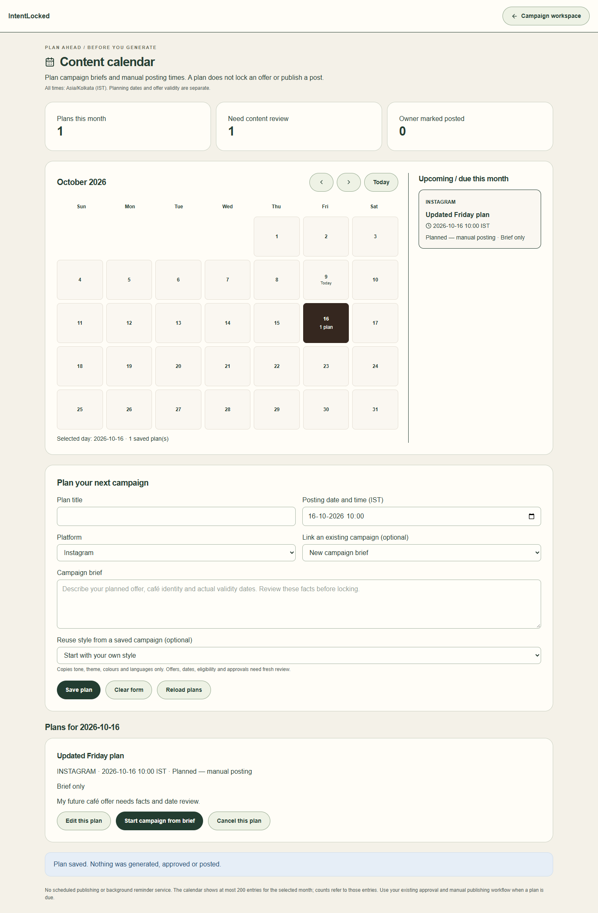
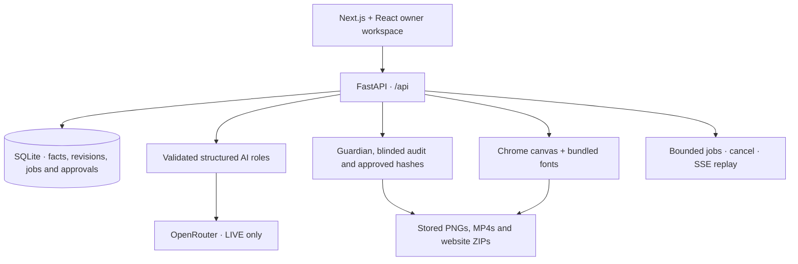

<div align="center">

# ☕ IntentLocked

### Your café's ideas. Your approved facts. Campaigns you control.

Turn a spoken or typed brief into multilingual campaign copy, café posters,
animated videos and a downloadable website—with owner review before export.

**English · ಕನ್ನಡ · Kanglish** &nbsp; | &nbsp; **Voice + text** &nbsp; | &nbsp; **Owner-approved output**

[Quick start](#quick-start) · [Owner workflow](#from-idea-to-approved-campaign) · [Visual guide](#visual-guide) · [Configuration](#models-and-configuration) · [Documentation](#documentation)


<sub><strong>Design inspiration supplied by the project owner.</strong> This is a reference, not generated project output. Its café name, 25% offer and food items are not imported into campaigns.</sub>

</div>

---

## What is IntentLocked?

IntentLocked helps café owners create a campaign without losing the details that
matter: café identity, products, offer, dates and eligibility. You review those
facts and the wording used in each language, then lock them. AI proposes creative
content; code checks it against your approved intent.

**Human controls truth. AI assists creation. Code enforces the boundary.**

An owner can plan a weekend coffee offer, review English and Kannada wording,
create captions and posters, compare alternative copy, audit the final output,
and download approved files. The owner then posts manually through saved social
profile links.

## What you can do

| Feature | How it helps the café owner |
| --- | --- |
| 🎙️ Voice or text brief | Speak when supported, or type. Edit the transcript before reviewing facts. |
| 🔒 Fact lock | Confirm the offer, dates, café details and localized forms. Unspecified rules stay unknown. |
| 🌏 Multilingual copy | Generate selected English, Kannada and Kanglish combinations for Instagram, Facebook and WhatsApp. |
| 🎨 Café posters | Choose photographic AI artwork or a labeled local illustration; code adds exact approved text. |
| 📊 Compare alternatives | Inspect rule features, paired simulated-persona judgments, accepted/rejected edits and stop reasons. |
| 🛡️ Guardian + customer audit | Check factual consistency and what a customer would understand before approval. |
| 🎬 Local animated MP4 | Animate a validated current poster for 12, 18 or 24 seconds using FFmpeg. |
| 🌐 Café website | Review a saved website draft and download a static ZIP. Optional hosting needs separate authorization. |
| 📅 Content calendar | Plan a brief and manual posting time; link current approved output when ready. |
| 📤 Approve + Export | Approve exact content/image hashes before authorized downloads, description copy and optional ZIP export. |
| 🔄 Saved progress | Reload completed work, cancel jobs and explicitly retry failures without silently repeating everything. |

Preference scores describe **simulated judgments**, not real customer research,
CTR forecasts or guaranteed campaign improvement. Missing scores remain unscored.

## From idea to approved campaign



| Workspace panel | What you do |
| --- | --- |
| **1. Speak** | Enter the brief; correct the transcript or typed text. |
| **2. Facts Lock** | Resolve required details, answer clarifications, review language forms and lock them. |
| **3. Strategy** | Review proposed audiences and choose combinations to generate. |
| **4. Campaign** | Generate copy, inspect saved drafts, render posters and optionally create animation. |
| **5. Predict** | Compare a selected audience/language group through bounded optimization. |
| **6. Guardian** | Inspect validation findings and remaining required checks. |
| **7. Changes** | Review proposed edits and their consequences; confirm fact changes explicitly. |
| **8. Approve** | Audit, acknowledge warnings, approve exact current items and authorize export. |

**A ready draft is not an approved asset.** Changing facts, wording, fonts or
layout can invalidate related renders, audits and approvals. Old output stays
historical; opening it does not make it current again.

### Posting to Instagram, Facebook and WhatsApp

In **Approve + Export → Your social profiles**, save your account links. After
approval and authorized export, download the poster, copy its description and
open your profile to post it yourself.

No Meta API key is needed for this owner flow. Opening a profile does not publish
or upload anything. A WhatsApp draft/chat link opens WhatsApp; it does not send,
attach the poster or publish a Status. Download the poster separately.
The calendar records planned/manual activity, not automatic scheduling or
platform-verified publishing.

## Visual guide

The café style uses cream paper, forest-green accents, mustard offer typography
and a right-side coffee hero. Promotional text comes from approved forms rather
than model-generated lettering. Products and claims from a reference are not
automatically permitted in your campaign.

<div align="center">

</div>

**Actual renderer example:** MOCK campaign copy with DETERMINISTIC local artwork,
UNAPPROVED. This demonstrates layout, not successful live AI photography or a
real café owner's sign-off. The reference above and this example have different
provenance.

<details>
<summary><strong>See the content calendar</strong></summary>



Offline test screenshot with sample plans. Posting time and offer validity are
separate; saving a plan does not lock facts, approve output or publish a post.

</details>

## Quick start

Start in **MOCK** mode to explore without a provider key or paid inference.
Initial dependency installation still needs internet access.

### Requirements

- **Python 3.11** and **uv**. The project requires Python `>=3.11,<3.12`.
- **Node.js 22+** and **npm**.
- Installed **Google Chrome**, and Node on `PATH`, for poster rendering.
- **FFmpeg + ffprobe** only if you want local MP4 animation.

Dependencies are pinned and locked in `pyproject.toml`, `uv.lock`,
`frontend/package.json` and `frontend/package-lock.json`.

### Windows PowerShell

From the repository root, install dependencies and start the backend:

```powershell
uv sync --locked
if (!(Test-Path .env)) { Copy-Item .env.example .env }
npm.cmd --prefix frontend ci --no-fund
.venv\Scripts\python.exe -m uvicorn backend.main:app --host 127.0.0.1 --port 8000 --workers 1
```

In a **second terminal**, from the same repository root:

```powershell
npm.cmd --prefix frontend run dev
```

### macOS / Linux / bash

```bash
uv sync --locked
test -e .env || cp .env.example .env
npm --prefix frontend ci --no-fund
.venv/bin/python -m uvicorn backend.main:app --host 127.0.0.1 --port 8000 --workers 1
```

In a **second terminal**, from the same repository root:

```bash
npm --prefix frontend run dev
```

| Open | Address |
| --- | --- |
| Campaign workspace | [http://127.0.0.1:3000](http://127.0.0.1:3000) |
| Content calendar | [http://127.0.0.1:3000/calendar](http://127.0.0.1:3000/calendar) |
| Interactive API docs | [http://127.0.0.1:8000/api/docs](http://127.0.0.1:8000/api/docs) |
| Backend readiness | [http://127.0.0.1:8000/api/ready](http://127.0.0.1:8000/api/ready) |

For a production frontend build, replace `run dev` with `run build`, then
`run start`. Stop each running terminal with **Ctrl+C**. Use one backend worker
and ports 8000/3000 for the documented local setup.

### First demo

1. Create a campaign and enter **your own** café identity, product, offer and dates.
2. Review facts and missing details. Mock wording is test output; review every
   selected language form before locking.
3. Lock facts, plan audiences and generate a small selection—one language and one
   channel is a useful starting point.
4. Choose a valid copy draft and **Local café artwork**, then render poster sizes.
5. Run the customer audit, review warnings and approve exact selected items.
6. Authorize export; download the poster and copy its approved description.

Typing is a normal workflow; microphone permission or speech support is not required.

## Models and configuration

Edit the ignored root `.env` privately. The safe `.env.example` defaults to
offline mock modes. The setup commands above preserve any existing `.env`.
Restart the backend after changing configuration.

| Operation | Selected model / engine | Server-side key |
| --- | --- | --- |
| Campaign text, structured roles and visual QA | `openai/gpt-4o-mini` through OpenRouter | `INFERENCE_API_KEY` |
| AI image generation | `bytedance-seed/seedream-5-0-flash` through OpenRouter | `INFERENCE_API_KEY` |
| Website visual plan | `qwen/qwen3-coder-flash` through OpenRouter | `OPENROUTER_API_KEY` |
| Local poster illustration | Deterministic application renderer | None |
| Local poster animation | FFmpeg + ffprobe | None |

The website model selects a validated visual plan. Code renders HTML/CSS and
factual text; raw model HTML, JavaScript and factual changes are not accepted.
Its mode/key configuration is separate from campaign inference.

Relevant safe settings:

```dotenv
INFERENCE_MODE=mock
INFERENCE_BASE_URL=https://openrouter.ai/api/v1
INFERENCE_API_KEY=
TEXT_MODEL=openai/gpt-4o-mini
IMAGE_PROVIDER=gateway
IMAGE_MODEL=bytedance-seed/seedream-5-0-flash
ENABLE_VISION=true

WEBSITE_AI_MODE=mock
WEBSITE_MODEL=qwen/qwen3-coder-flash
OPENROUTER_API_KEY=

LOCAL_VIDEO_ENABLED=true
ENABLE_VIDEO=false
VIDEO_MODEL=disabled
WEBSITE_PUBLISH_ENABLED=false
META_ENABLED=false
```

For real campaign inference, set `INFERENCE_MODE=live` and populate
`INFERENCE_API_KEY` privately. For real website layout inference, separately set
`WEBSITE_AI_MODE=live` and populate `OPENROUTER_API_KEY`. Both are OpenRouter
credentials in this profile; the optional direct OpenAI adapter is inactive,
so `OPENAI_API_KEY` stays blank.

**Image account status:** the last recorded authenticated Seedream image request
returned **HTTP 402 `PAYMENT_REQUIRED`**. Add provider credits before retrying.
New-prompt photographic output and visual QA are not verified by illustration or
mock tests. See [the recorded provider check](docs/SEEDREAM_SWITCH_2026-10-10.md).

Never commit keys, paste them into screenshots or place them in `NEXT_PUBLIC_*`
variables. Legacy Meta adapters remain disabled and are not used by the manual
profile-link interface.

### Enable local video

Windows, after installing project dependencies:

```powershell
.venv\Scripts\python.exe -m scripts.install_video_tools
```

This downloads checksum-verified FFmpeg/ffprobe into ignored project-local storage.
On Linux/macOS, install both through your system package manager. Verify with
`ffmpeg -version` and `ffprobe -version`.

Open **Saved video drafts → Local poster animation**. Audit/approve the source
poster, then review and approve the animation separately for authorized MP4
download. It is poster animation, not AI-generated camera footage. Remote AI
video generation remains disabled.

## How the project works



| Area | Location |
| --- | --- |
| API, services, persistence and approval gates | `backend/` |
| Versioned role prompts | `backend/prompts/` |
| Offline fixtures and backend tests | `backend/fixtures/`, `backend/tests/` |
| Workspace, calendar and owner controls | `frontend/app/`, `frontend/components/` |
| Shared poster renderer and bundled fonts | `frontend/public/renderer/`, `frontend/public/fonts/` |
| Browser workflow tests | `frontend/e2e/` |
| Smoke, verification and setup tools | `scripts/` |
| Contracts, decisions and captured evidence | `docs/` |
| Private local database and asset storage | `data/` — ignored by Git |

**MOCK** uses local fixture inference and cannot send external inference requests.
**LIVE** uses configured providers and may incur charges. **CACHED** is an explicit
saved-output view retaining its original provenance. Failures are not silently
presented as successful live output.

Keep `DATABASE_PATH` and `ASSET_PATH` on persistent writable storage. Reload and
SSE reconnect read saved state; a backend restart interrupts unfinished work
without automatically replaying inference. Optimization has finite rounds, call
budgets and deadlines; retries count toward the budget. Costs distinguish
estimates, reported charges and unknown values.

## Verification

Checks are scoped to their recorded code versions, not a blanket claim that
every account, language or hosting capability is verified.

| Recorded check | Outcome | Evidence |
| --- | --- | --- |
| Modern poster backend regressions | **74 passed** | [Test results](docs/evidence/modern-cafe-tests.xml) |
| Poster/optimization/media browser workflow | **8 passed**, MOCK inference; real Chrome PNGs and FFmpeg MP4 | [Browser results](docs/evidence/modern-cafe-browser-final.json) |
| Modern poster build, lint and secret scans | **Passed** | [Design report](docs/MODERN_CAFE_POSTERS_2026-10-10.md) |
| Synthetic live English campaign rehearsal | Passed recorded text/role flow with local artwork; test-owner approval simulated | [Hackathon report](docs/HACKATHON_VERIFICATION_2026-10-10.md) |
| New-prompt live image / visual QA | **Not tested**; preceding authenticated request returned 402 | [Seedream report](docs/SEEDREAM_SWITCH_2026-10-10.md) |
| Native Kannada / voice review | **Manual checks pending** | [Review checklist](docs/KANNADA_NATIVE_REVIEW.md) |

### Run checks yourself

PowerShell, from the repository root:

```powershell
.venv\Scripts\python.exe -m pytest -q
.venv\Scripts\python.exe -m ruff check backend scripts
npm.cmd --prefix frontend run lint
npm.cmd --prefix frontend run build
.venv\Scripts\python.exe -m scripts.check_repository_secrets
.venv\Scripts\python.exe -m scripts.check_frontend_secrets
```

Bash uses `.venv/bin/python` and `npm` for equivalent commands.

For isolated browser verification, **stop ordinary local servers first** and
build the frontend. The verifier starts and cleans up its own MOCK test servers:

```powershell
.venv\Scripts\python.exe -m scripts.verify_workflow
```

After configuring live credentials and credits, this optional image probe sends
real requests and may incur charges:

```powershell
.venv\Scripts\python.exe -m scripts.probe_hackathon_image
```

It records actual outcomes; missing credentials do not become verified results.
Captured reports live under `docs/evidence/`.

## Troubleshooting

| Symptom | What to check |
| --- | --- |
| Backend unavailable | Start port 8000 and open `/api/ready`. Keep the frontend on port 3000. |
| Image request returns 402 | Check OpenRouter credits. Choose **Local café artwork** explicitly to continue with illustration. |
| Image request returns 401 | Check the server key/provider pairing privately, then restart the backend. |
| Old poster design still visible | Render new sizes. Historical PNGs stay unchanged; new output needs audit/approval. |
| Poster copy selector is empty | Finish/retry failed copy cells and select a valid current draft. |
| Poster fails to render | Check Chrome, Node on PATH, bundled fonts and text overflow. Do not bypass validation. |
| Website edits are incomplete | Finish both opening/closing times or remove the day; fix incomplete menu rows. Navigation preserves edits. |
| MP4 option unavailable | Install FFmpeg/ffprobe, enable local animation and select a validated current poster. |
| Approval/export blocked | Review revision, Guardian findings, required audit, warnings and exact asset hashes. |
| Backend restarted during work | Reload saved state, inspect interrupted work and explicitly retry. |
| Microphone unavailable | Type the brief or edit the transcript; speech is optional. |

This is a **local single-owner profile**. It has no public login system; loopback,
Host and CORS checks do not replace authentication. Public multi-user deployment
requires completing the security/release work.

## Documentation

| Read this for… | Guide |
| --- | --- |
| Implementation guide and stage gates | [Project build prompts](docs/AGNES_PROJECT_BUILD_PROMPTS.md) |
| API/data contracts and progress | [Interfaces](docs/INTERFACES.md) · [Progress](docs/PROGRESS.md) · [Requirements matrix](docs/REQUIREMENTS_MATRIX.md) |
| Modern design and provenance | [Modern posters](docs/MODERN_CAFE_POSTERS_2026-10-10.md) · [Art boundary](docs/ART_BOUNDARY.md) |
| Validation and approval | [Guardian](docs/GUARDIAN_BOUNDARY.md) · [Delivery](docs/DELIVERY_BOUNDARY.md) |
| Optimization and scoring | [Optimization boundary](docs/OPTIMIZATION_BOUNDARY.md) |
| Social links | [Manual publishing](docs/MANUAL_SOCIAL_PUBLISHING.md) |
| Content planning | [Calendar](docs/CONTENT_CALENDAR.md) |
| Website generation and recovery | [Website design](docs/WEBSITE_V2_DESIGN.md) · [OpenRouter setup](docs/WEBSITE_OPENROUTER.md) · [Recovery](docs/WEBSITE_RECOVERY_2026-10-10.md) |
| Jobs and reconnect/retry | [Workflow recovery](docs/WORKFLOW_RECOVERY.md) |
| Security/release limitations | [Security and release](docs/SECURITY_AND_RELEASE.md) |

Older provider and stage reports are historical evidence, not current model
configuration. Follow `.env.example` and the selected configuration above.

---

<div align="center">
<strong>Make something worth sharing. Keep the facts worth trusting.</strong><br />
<sub>IntentLocked · Café marketing with the owner in control.</sub>
</div>
